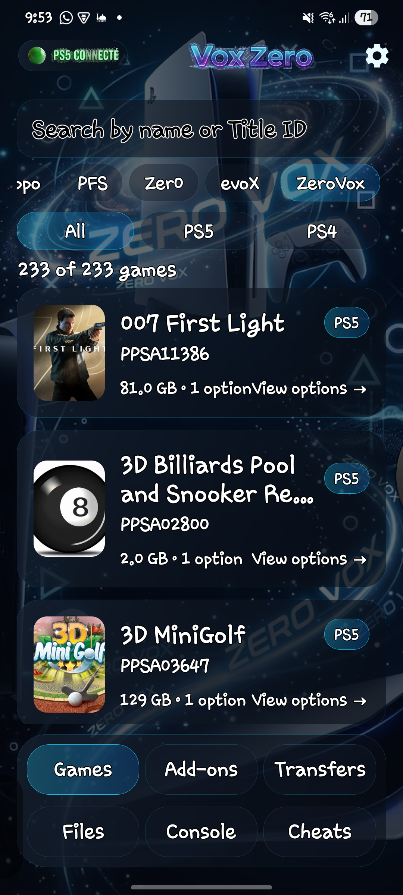
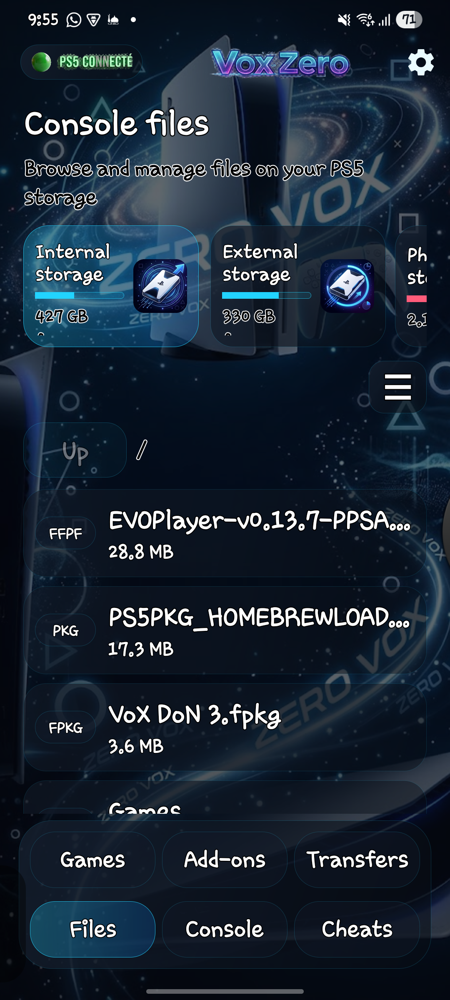
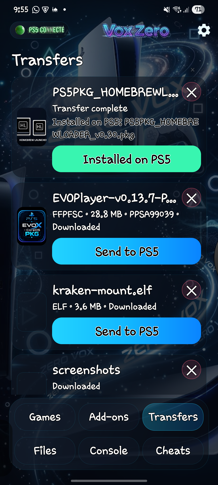

<p align="center">
  
  
  
</p>

<h1 align="center">Zero Vox</h1>

<p align="center">
  An Android app for browsing PS5 &amp; PS4 game catalogues, transferring files to the console, and managing CheatRunner lists.
</p>

<p align="center">
  <b>Android</b> · <b>PS5 / PS4 catalogue</b> · <b>Local transfers</b> · <b>CheatRunner</b>
</p>

---

## Overview

**Zero Vox** is an Arabic-first Android app that brings the game catalogue, local network transfers, and CheatRunner lists together in one place. It is designed to be lightweight and fast, with a dark glass-style UI, full right-to-left (RTL) support, and translations into Arabic, English, French, Spanish, and Korean.

> The app hosts no games. Use it only with content you have the right to access.

## Features

- **Unified catalogue:** Browse PS5 and PS4 games with search by name or Title ID.
- **Clear filtering:** Filters for All, PS5, and PS4 games, with badges for type, region, and file size.
- **Transfer to PS5:** Send files from your phone to the console over the local network, with progress tracking and verification.
- **Download queue:** Monitor PS5 jobs — pause, resume, or retry them.
- **CheatRunner lists:** View installed games, open cheat files, and toggle cheats while a game is running.
- **Full customization:** Dark/light mode, haptics, language switching in settings, and RTL support.
- **No sign-in:** No account and no cloud — settings stay on your phone.

## Requirements

- Android 8.0 or newer.
- Phone and PS5 on the same Wi-Fi network.
- The PS5 companion service running on the console for connection and transfer operations.
- **CheatRunner** is optional and uses the default port `9999`.

## Installation

1. Download the APK from the [releases page](https://github.com/VoxDon3/ZeroVox/releases/latest) or the [direct link](https://github.com/VoxDon3/ZeroVox/releases/download/v1.0.1/ZeroVox-1.0.1-release.apk).
2. Allow installation from unknown sources if prompted.
3. Open Zero Vox, then enter the PS5 address and pairing code in settings.
4. After pairing, open the **Games** tab to load the catalogue.

> **Important:** Version 1.0.1 is signed with a new release key. If you have a previous 1.0.1 debug build, uninstall it first — it will not update automatically to the release build. Uninstalling deletes local data.

APK SHA-256 fingerprint:

```text
6def49f8c549da3e145deddbe10b3085ca8a36703823289d5b92c027b2f281c2
```

## CheatRunner setup

1. Install and run CheatRunner on the PS5.
2. Make sure the phone and console are on the same network.
3. Open the **Cheats** tab in Zero Vox.
4. The app uses the same PS5 address with port `9999`, and lists installed PS5 and PS4 games in two separate sections.

## Building from source

```bash
git clone https://github.com/VoxDon3/ZeroVox.git
cd ZeroVox
./gradlew testDebugUnitTest lintDebug assembleDebug
```

The debug APK is produced at:

```text
app/build/outputs/apk/debug/app-debug.apk
```

To build a signed release, create a `keystore.properties` file in the project root (excluded from git) with `storeFile`, `storePassword`, `keyAlias`, and `keyPassword`, then:

```bash
./gradlew assembleRelease
```

Without `keystore.properties`, the release APK will be unsigned.

## Privacy &amp; usage

- The app collects no personal data and sends none to its own servers.
- Connection addresses and the pairing code are stored locally on the phone only.
- The app uses HTTP over the local network to talk to the PS5 service and CheatRunner; it sends no data to external servers of its own.
- Never share your pairing code with anyone.
- Zero Vox is an independent local management tool and is not a replacement for official PlayStation services.
- Use the app only with content you own or have the right to use.

## License

This project is intended for personal use. See the license file in the repository if one is provided.

---

<p align="center"><sub>Zero Vox — built for a cleaner console workflow.</sub></p>
