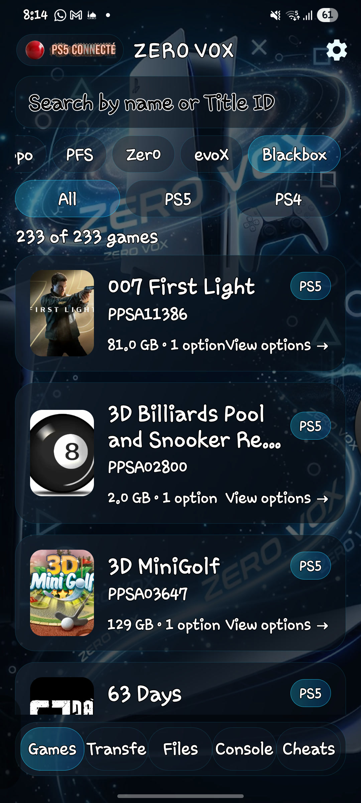

<p align="center">
  
</p>

<h1 align="center">Zero Vox</h1>

<p align="center">
  تطبيق أندرويد لاستعراض كتالوج ألعاب PS5 وPS4، ونقل الملفات إلى الجهاز، وإدارة قوائم CheatRunner.
</p>

<p align="center">
  <b>Android</b> · <b>PS5 / PS4 catalogue</b> · <b>Local transfers</b> · <b>CheatRunner</b>
</p>

---

## نظرة عامة

**Zero Vox** واجهة عربية أولًا لأندرويد تجمع كتالوج الألعاب، وإدارة النقل عبر الشبكة المحلية، وقوائم CheatRunner في تطبيق واحد. صُمم التطبيق ليكون خفيفًا وسريعًا، مع واجهة داكنة زجاجية، دعم كامل للاتجاه من اليمين إلى اليسار، وترجمة إلى العربية والإنجليزية والفرنسية والإسبانية والكورية.

> التطبيق لا يستضيف أي ألعاب. استخدمه فقط مع المحتوى الذي تملك حق استخدامه.

## المزايا

- **كتالوج موحّد:** تصفح ألعاب PS5 وألعاب PS4، مع بحث بالاسم أو Title ID.
- **تصنيف واضح:** فلاتر لكل الألعاب، PS5، وPS4، مع شارات النوع والمنطقة وحجم الملف.
- **نقل إلى PS5:** أرسل الملفات من الهاتف إلى الجهاز عبر الشبكة المحلية، مع متابعة التقدم والتحقق.
- **طابور التنزيل:** راقب عمليات PS5، وأوقفها أو استأنفها أو أعد المحاولة.
- **قوائم CheatRunner:** اعرض الألعاب المثبتة، افتح ملفات Cheat، وبدّل الإضافات عندما يكون اللعب نشطًا.
- **تخصيص كامل:** الوضع الداكن والفاتح، الاهتزاز عند الضغط، تغيير اللغة من الإعدادات، ودعم RTL.
- **بدون تسجيل دخول:** لا حساب ولا سحابة؛ الإعدادات تبقى على الهاتف.

## المتطلبات

- أندرويد 8.0 أو أحدث.
- الهاتف وجهاز PS5 على نفس شبكة Wi-Fi.
- خدمة الـ PS5 المصاحبة تعمل على الجهاز لعمليات الاتصال والنقل.
- **CheatRunner** اختياري، ويعمل على المنفذ الافتراضي `9999`.

## التثبيت

1. نزّل ملف APK من [صفحة الإصدارات](https://github.com/VoxDon3/ZeroVox/releases/latest) أو من [الرابط المباشر](https://github.com/VoxDon3/ZeroVox/releases/download/v1.0.1/ZeroVox-1.0.1-debug.apk).
2. اسمح بتثبيت التطبيقات من المصدر غير المعروف إذا طلب النظام ذلك.
3. افتح Zero Vox، ثم أدخل عنوان PS5 ورمز الاقتران من الإعدادات.
4. بعد الاقتران، افتح تبويب **Games** لتحميل الكتالوج.

## إعداد CheatRunner

1. ثبّت CheatRunner وشغّله على PS5.
2. تأكد أن الهاتف والجهاز على نفس الشبكة.
3. افتح تبويب **Cheats** في Zero Vox.
4. يستخدم التطبيق عنوان PS5 نفسه مع المنفذ `9999`، ويعرض ألعاب PS5 وPS4 المثبتة في قسمين منفصلين.

## البناء من المصدر

```bash
git clone https://github.com/VoxDon3/ZeroVox.git
cd ZeroVox
./gradlew assembleDebug
```

ينتج ملف APK في:

```text
app/build/outputs/apk/debug/app-debug.apk
```

## الخصوصية والاستخدام

- لا يجمع التطبيق بيانات شخصية ولا يرسلها إلى خوادم تابعة له.
- عناوين الاتصال ورمز الاقتران تُحفظ محليًا على الهاتف فقط.
- لا تشارك رمز الاقتران مع أي شخص.
- Zero Vox أداة إدارة محلية مستقلة، وليست بديلًا عن خدمات PlayStation الرسمية.
- استخدم التطبيق فقط مع المحتوى الذي تملك حق الوصول إليه أو استخدامه.

## الترخيص

هذا المشروع مخصص للاستخدام الشخصي. راجع ملف الترخيص في المستودع إن وجد.

---

<p align="center"><sub>Zero Vox — built for a cleaner console workflow.</sub></p>
